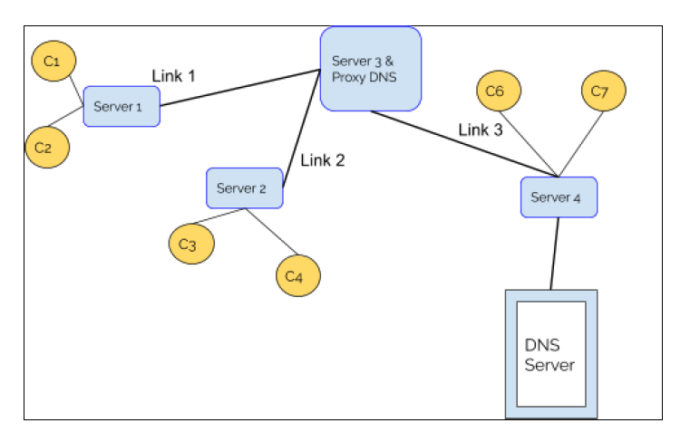
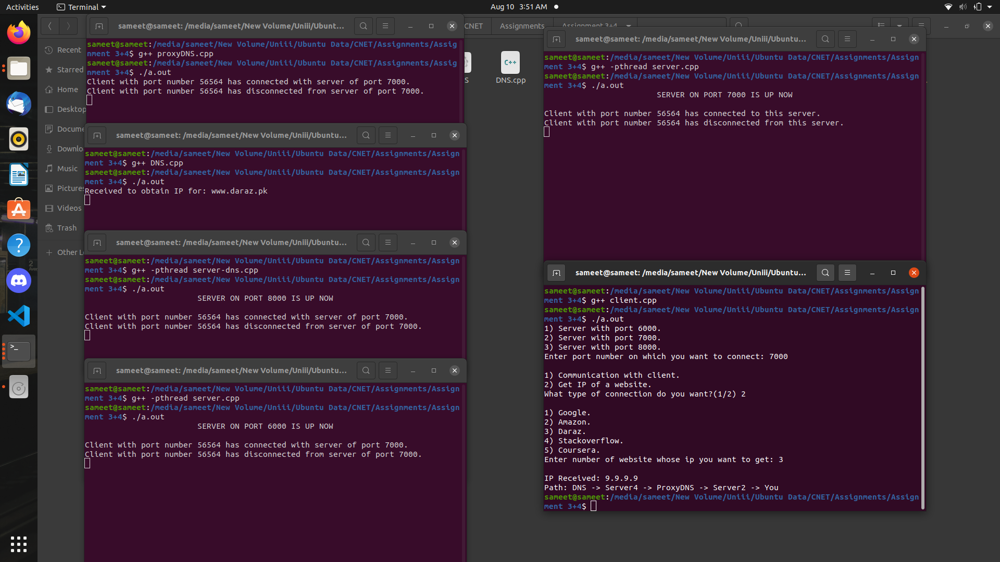
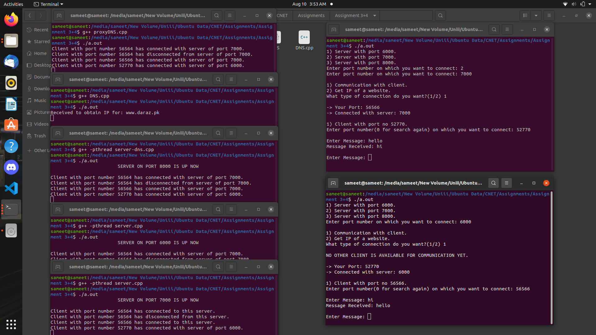

# Chat Relay

A C++ socket-programming project that models a complete local TCP network: multiple chat servers, clients, a proxy DNS service, a server-aware DNS layer, and an authoritative domain lookup service.


## Features

- Connect clients to any of three chat servers.
- Exchange messages between connected clients.
- Resolve a predefined set of domain names through layered DNS services.
- Maintain client/server routing information in the proxy layer.
- Handle multiple connections with `select` and POSIX threads.
- Run the full topology locally over loopback networking.

See [Network architecture](docs/ARCHITECTURE.md) for component responsibilities, ports, and data flow. The system specification is available in [docs/system-specification.pdf](docs/system-specification.pdf).

## Build

The programs use POSIX sockets and should be built on Linux or another Unix-like system.

```bash
make
```

This creates five executables in `build` and copies `data/domains.txt` beside them.

## Run the topology

Open separate terminals, change into `build` in each, and start the components in this order:

```bash
./dns
./proxy-dns
./server-dns
./server
./server
./client
```

Start additional `server` or `client` processes as needed. The interactive server prompt assigns ports from the configured 6000, 7000, and 8000 range. Default DNS and proxy services use ports 5000 and 9000.

`data/domains.txt` contains the configured domain mappings. These are static values used by the network rather than live DNS records.

## Screenshots

| Network topology | Domain lookup |
| --- | --- |
|  |  |



## Project status

The protocol and application code are supported by reproducible builds, topology documentation, and automated compilation checks.

## License

Licensed under the [MIT License](LICENSE).
